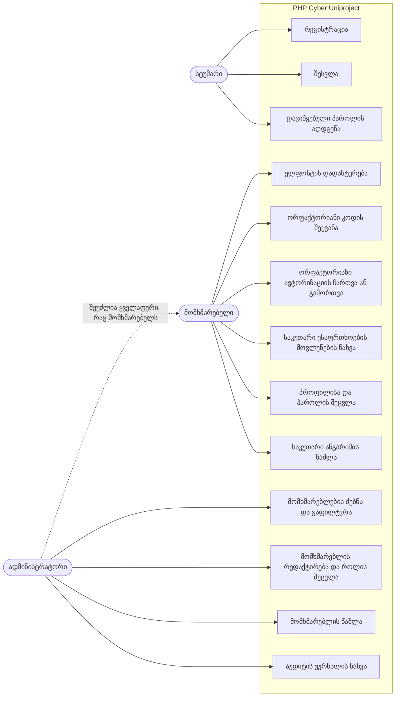
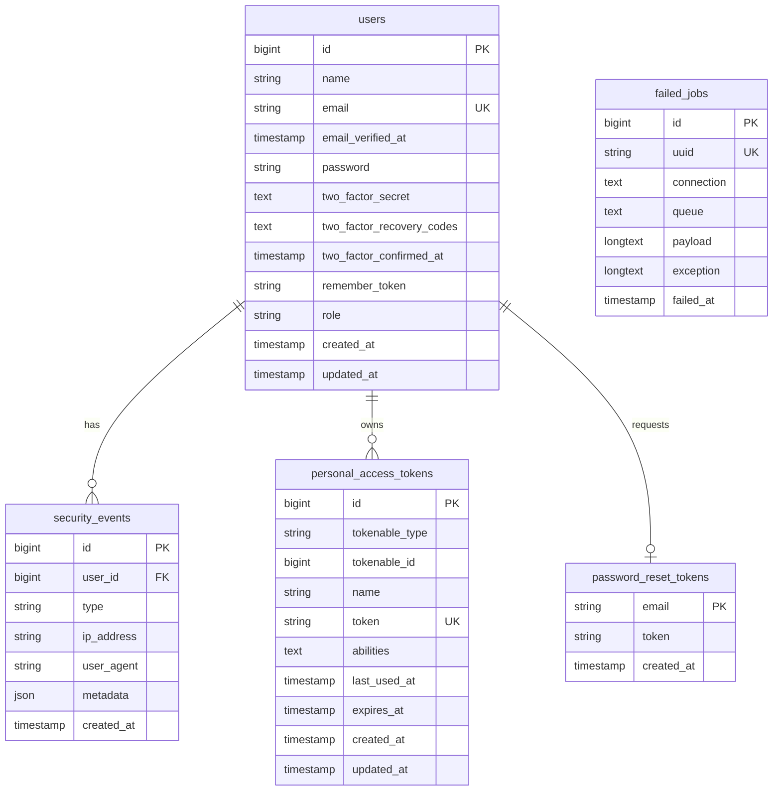

<h1 align="center">PHP Cyber Uniproject</h1>

<p align="center">
  Laravel ვებ აპლიკაცია, რომელიც აჩვენებს ანგარიშის დაცვას: ორფაქტორიანი ავტორიზაცია, როლებზე დაფუძნებული წვდომა ადმინ პანელზე, უსაფრთხოების აუდიტის ჟურნალი და ბრაუზერის უსაფრთხოების ჰედერები.
</p>

<p align="center">
  
  
  
  
  
  <a href="LICENSE"></a>
  <a href="https://github.com/MrTabaOfficial/PHP-Cyber-Uniproject/actions/workflows/ci.yml"></a>
</p>

<p align="center">
  <a href="README.md">English</a> | <strong>ქართული</strong>
</p>


## პროექტის შესახებ

აპლიკაცია მცირე ზომის ანგარიშების სისტემაა. სტუმარი რეგისტრირდება და ადასტურებს ელფოსტას. ავტორიზებული მომხმარებელი მართავს პროფილს, რთავს ორფაქტორიან ავტორიზაციას და ხედავს საკუთარ ანგარიშზე მომხდარ ბოლო უსაფრთხოების მოვლენებს. ადმინისტრატორი მართავს მომხმარებლებს და კითხულობს ყველა ანგარიშის აუდიტის ჟურნალს. რეალურ გარემოში მას არავინ იყენებს. მისი მიზანია აჩვენოს, როგორ იწერება და იტესტება ეს დაცვის მექანიზმები.

პროექტი 2023 წლის დეკემბერში დავიწყე, როგორც საუნივერსიტეტო დავალება კიბერუსაფრთხოებაში. მაშინ მასში იყო შესვლა, QR კოდი ორფაქტორიანი ავტორიზაციისთვის და ადმინ გვერდის პირველი ვერსია. 2026 წლის ოქტომბერში ის გადავამუშავე: Laravel 10-დან გადავიტანე Laravel 13-ზე, გავასწორე როლის შემოწმება, რომელიც შეცდომას აგდებდა, და დავამატე ადმინ პანელი, აუდიტის ჟურნალი, ორფაქტორიანი ავტორიზაციის სრული პროცესი, უსაფრთხოების ჰედერები და ტესტები. ამ პროექტზე ვივარჯიშე Laravel Fortify-ში, TOTP ორფაქტორიან ავტორიზაციაში, policy-ებსა და middleware-ში, event listener-ებში, HTTP უსაფრთხოების ჰედერებსა და feature ტესტების წერაში.

> [!NOTE]
> ეს სასწავლო პროექტია სატესტო მონაცემებით. seeder ქმნის სადემონსტრაციო ანგარიშებს საჯარო პაროლით და 18 გამოგონილ მომხმარებელს. აპლიკაცია არსად არის განთავსებული.

## სარჩევი

- [შესაძლებლობები](#შესაძლებლობები)
- [ეკრანის სურათები](#ეკრანის-სურათები)
- [გამოყენების შემთხვევების დიაგრამა](#გამოყენების-შემთხვევების-დიაგრამა)
- [მონაცემთა ბაზა](#მონაცემთა-ბაზა)
- [ტექნოლოგიები](#ტექნოლოგიები)
- [პროექტის სტრუქტურა](#პროექტის-სტრუქტურა)
- [გაშვება](#გაშვება)
- [Route-ები](#route-ები)
- [უსაფრთხოება](#უსაფრთხოება)
- [გამოყენებული რესურსები](#გამოყენებული-რესურსები)
- [ლიცენზია](#ლიცენზია)

## შესაძლებლობები

**საჯარო ნაწილი**

- მთავარი გვერდის ნახვა, სადაც პროექტია აღწერილი.
- რეგისტრაცია სახელით, ელფოსტით და პაროლით, რომელიც პაროლის წესებს აკმაყოფილებს.
- პაროლის აღდგენის ბმულის მოთხოვნა და ახალი პაროლის დაყენება.

**ანგარიში**

- შესვლა ელფოსტით და პაროლით, სურვილისამებრ „დამიმახსოვრე“ ოფციით.
- ელფოსტის დადასტურება ხელმოწერილი ბმულით.
- ორფაქტორიანი ავტორიზაციის ჩართვა: QR კოდის დასკანერება ან გასაღების ხელით შეყვანა და 6-ნიშნა კოდით დადასტურება.
- რვა ერთჯერადი აღდგენის კოდის შენახვა, ახლების გენერაცია ან ორფაქტორიანი ავტორიზაციის გამორთვა.
- პაროლის შემდეგ შესვლა 6-ნიშნა კოდით ან აღდგენის კოდით.
- მთავარ პანელზე (dashboard) ელფოსტის, ორფაქტორიანი ავტორიზაციისა და როლის სტატუსის ნახვა.
- ანგარიშის ბოლო 10 უსაფრთხოების მოვლენის ნახვა დროით, IP მისამართით და ბრაუზერით.
- სახელის, ელფოსტისა და პაროლის შეცვლა ან ანგარიშის წაშლა.

**ადმინისტრირება**

- მომხმარებლების ძებნა სახელით ან ელფოსტით და გაფილტვრა როლით.
- იმის ნახვა, რომელ მომხმარებელს აქვს დადასტურებული ელფოსტა და ჩართული ორფაქტორიანი ავტორიზაცია.
- მომხმარებლის სახელის, ელფოსტისა და როლის შეცვლა და მისი ბოლო უსაფრთხოების მოვლენების ნახვა.
- მომხმარებლის წაშლა დადასტურების ფანჯრის შემდეგ.
- ყველა ანგარიშის აუდიტის ჟურნალის ნახვა და გაფილტვრა მოვლენის ტიპით, ელფოსტით ან IP მისამართით.

## ეკრანის სურათები

| მთავარი გვერდი | შესვლა |
| --- | --- |
|  |  |

| რეგისტრაცია | Dashboard |
| --- | --- |
|  |  |

| პროფილი | ორფაქტორიანი ავტორიზაციის გამართვა |
| --- | --- |
|  |  |

| აღდგენის კოდები | კოდის მოთხოვნა შესვლისას |
| --- | --- |
|  |  |

| მომხმარებლები | მომხმარებლის რედაქტირება |
| --- | --- |
|  |  |

| წაშლის დადასტურება | აუდიტის ჟურნალი |
| --- | --- |
|  |  |

მობილურზე, გახსნილი მენიუთი:


სურათებზე ნაჩვენები გასაღები და აღდგენის კოდები ლოკალური სადემონსტრაციო ბაზიდანაა, რომელიც მას შემდეგ თავიდან შეიქმნა.

## გამოყენების შემთხვევების დიაგრამა



## მონაცემთა ბაზა



ერთ მომხმარებელს ბევრი უსაფრთხოების მოვლენა აქვს. მომხმარებლის წაშლისას `security_events.user_id` ხდება null, ამიტომ ჩანაწერი რჩება. `password_reset_tokens` მომხმარებელს ელფოსტით უკავშირდება, foreign key-ის გარეშე. `personal_access_tokens` და `failed_jobs` Laravel-ის საწყისი პროექტიდან მოდის და ამ აპლიკაციის არცერთი ფუნქცია მათში არ წერს.

## ტექნოლოგიები

| შრე | ტექნოლოგია |
| --- | --- |
| ენა | PHP 8.3+ |
| Framework | Laravel 13 |
| ავტორიზაცია | Laravel Fortify 1.41 (შესვლა, პაროლის დადასტურება, TOTP ორფაქტორიანი ავტორიზაცია) |
| მონაცემთა ბაზა | ნაგულისხმევად SQLite, Eloquent-ითა და migration-ებით |
| შაბლონები | Blade კომპონენტები |
| სტილები | Tailwind CSS 4 და `@tailwindcss/forms` |
| კლიენტის მხარე | Alpine.js 3 (dropdown, modal, მობილური მენიუ) |
| Asset-ების აწყობა | Vite 8 და `laravel-vite-plugin` |
| ტესტები | PHPUnit 12, 86 feature ტესტი SQLite-ზე ოპერატიულ მეხსიერებაში |
| კოდის სტილი | Laravel Pint |
| CI | GitHub Actions |

## პროექტის სტრუქტურა

```text
PHP-Cyber-Uniproject/
├── .github/workflows/ci.yml            # აწყობა, სტილის შემოწმება, ტესტები, დამოკიდებულებების აუდიტი
├── app/
│   ├── Enums/
│   │   ├── Role.php                    # user / admin
│   │   └── SecurityEventType.php       # აუდიტის ჟურნალის ყველა მოვლენა, სახელითა და ფერით
│   ├── Http/
│   │   ├── Controllers/
│   │   │   ├── Admin/
│   │   │   │   ├── AuditLogController.php  # ყველა მოვლენის სია ფილტრებით
│   │   │   │   └── UserController.php  # სია, რედაქტირება, როლის შეცვლა, წაშლა
│   │   │   ├── Auth/                   # რეგისტრაცია, ელფოსტის დადასტურება, პაროლის აღდგენა
│   │   │   ├── DashboardController.php # ანგარიშის სტატუსი და საკუთარი მოვლენები
│   │   │   ├── ProfileController.php   # პროფილის შეცვლა, ანგარიშის წაშლა
│   │   │   └── TwoFactorSettingsController.php  # ორფაქტორიანი ავტორიზაციის გვერდი
│   │   ├── Middleware/
│   │   │   ├── EnsureTwoFactorEnabled.php  # ადმინს სავალდებულოდ სჭირდება ორფაქტორიანი ავტორიზაცია
│   │   │   ├── EnsureUserIsAdmin.php   # 403 მათთვის, ვინც ადმინი არ არის
│   │   │   └── SecurityHeaders.php     # CSP, HSTS, frame-ის აკრძალვა, no-store
│   │   └── Requests/Admin/UpdateUserRequest.php  # მომხმარებლის ფორმის validation
│   ├── Listeners/RecordSecurityEvents.php  # auth event-ები -> აუდიტის ჟურნალი
│   ├── Models/
│   │   ├── SecurityEvent.php           # ჟურნალის ერთი ჩანაწერი, იშლება 90 დღის შემდეგ
│   │   └── User.php                    # როლის cast, ორფაქტორიანი ავტორიზაცია, კავშირი მოვლენებთან
│   ├── Policies/UserPolicy.php         # ვის შეუძლია რედაქტირება, როლის შეცვლა, წაშლა
│   └── Providers/
│       ├── AppServiceProvider.php      # პაროლის წესები
│       └── FortifyServiceProvider.php  # შესვლისა და ორფაქტორიანი კოდის ლიმიტები
├── config/
│   ├── fortify.php                     # ორფაქტორიანი ავტორიზაცია დადასტურებით
│   └── security.php                    # ადმინის წესი, ჟურნალის შენახვის ვადა
├── database/
│   ├── factories/UserFactory.php       # admin() და withTwoFactor() state-ები
│   ├── migrations/                     # users, role, ორფაქტორიანი სვეტები, security_events
│   └── seeders/DatabaseSeeder.php      # სადემონსტრაციო ანგარიშები და მომხმარებლები
├── docs/screenshots/                   # ამ README-ში გამოყენებული სურათები
├── resources/
│   ├── css/app.css                     # Tailwind CSS 4-ის კონფიგურაცია
│   ├── js/app.js                       # Alpine.js-ის გაშვება
│   └── views/
│       ├── admin/                      # მომხმარებლებისა და აუდიტის ჟურნალის გვერდები
│       ├── auth/                       # შესვლა, რეგისტრაცია, ორფაქტორიანი კოდის მოთხოვნა
│       ├── components/                 # ღილაკები, badge-ები, უსაფრთხოების მოვლენების ცხრილი
│       ├── layouts/                    # app და guest layout-ები, ნავიგაცია
│       ├── profile/                    # პროფილი და ორფაქტორიანი ავტორიზაციის პარამეტრები
│       ├── dashboard.blade.php         # dashboard
│       └── welcome.blade.php           # მთავარი გვერდი
├── routes/
│   ├── auth.php                        # რეგისტრაცია, ელფოსტის დადასტურება, პაროლის აღდგენა
│   └── web.php                         # dashboard, პროფილი, ადმინ პანელი
└── tests/Feature/
    ├── Admin/UserManagementTest.php    # წვდომის კონტროლი, როლის შეცვლა, წაშლა
    ├── Auth/                           # შესვლა, რეგისტრაცია, აღდგენა, დადასტურება
    ├── Security/
    │   ├── AuditLogTest.php            # რომელი მოვლენები იწერება
    │   ├── ConfigurationTest.php       # საიდუმლო მნიშვნელობები, სესია, host-ის შემოწმება
    │   ├── PasswordPolicyTest.php      # სუსტი პაროლების უარყოფა
    │   ├── SecurityHeadersTest.php     # ჰედერები და inline სკრიპტების არარსებობა
    │   └── TwoFactorAuthenticationTest.php  # გამართვა, კოდის მოთხოვნა, აღდგენის კოდები
    ├── ProfileTest.php                 # პროფილის შეცვლა და ანგარიშის წაშლა
    └── RoleTest.php                    # ნაგულისხმევი როლი, mass assignment
```

## გაშვება

რა არის საჭირო:

- PHP 8.3 ან უფრო ახალი, `pdo_sqlite`, `mbstring`, `openssl` და `fileinfo` extension-ებით
- Composer 2
- Node.js 20 ან უფრო ახალი

ნაბიჯები:

1. დააკლონეთ repository.

   ```bash
   git clone https://github.com/MrTabaOfficial/PHP-Cyber-Uniproject.git
   cd PHP-Cyber-Uniproject
   ```

2. დააინსტალირეთ PHP და JavaScript დამოკიდებულებები.

   ```bash
   composer install
   npm ci
   ```

3. შექმენით `.env`, აპლიკაციის გასაღები, SQLite ბაზის ფაილი `database/database.sqlite`, ცხრილები და სატესტო მონაცემები.

   ```bash
   composer setup
   ```

   ეს ბრძანება უშვებს `migrate:fresh --seed`-ს, ამიტომ ყოველ გაშვებაზე ლოკალურ ბაზას შლის.

4. ააწყვეთ CSS და JavaScript.

   ```bash
   npm run build
   ```

5. გაუშვით სერვერი და გახსენით <http://localhost:8000>.

   ```bash
   php artisan serve
   ```

პირველი შესვლა:

| როლი | ელფოსტა | პაროლი |
| --- | --- | --- |
| ადმინისტრატორი | `admin@example.com` | `Demo-Passw0rd!` |
| მომხმარებელი | `user@example.com` | `Demo-Passw0rd!` |

ადმინისტრატორმა ადმინ გვერდების გახსნამდე ორფაქტორიანი ავტორიზაცია უნდა გამართოს. შედით, დააჭირეთ **Users**-ს, დაადასტურეთ პაროლი და დაასკანერეთ QR კოდი ნებისმიერი authenticator აპლიკაციით.

წერილები არ იგზავნება. ნაგულისხმევი `MAIL_MAILER=log` პარამეტრით ელფოსტის დადასტურებისა და პაროლის აღდგენის ბმულები იწერება ფაილში `storage/logs/laravel.log`.

ტესტები და კოდის სტილი:

```bash
composer test
composer lint
```

პარამეტრები `.env` ფაილში:

| ცვლადი | ნაგულისხმევი | მნიშვნელობა |
| --- | --- | --- |
| `SECURITY_ADMIN_REQUIRES_2FA` | `true` | ადმინისტრატორმა ადმინ გვერდების გამოყენებამდე ორფაქტორიანი ავტორიზაცია უნდა ჩართოს. |
| `SECURITY_AUDIT_RETENTION_DAYS` | `90` | რამდენი დღის შემდეგ შლის ყოველდღიური `model:prune` უსაფრთხოების მოვლენას. |
| `SESSION_ENCRYPT` | `true` | სესიის მონაცემები ინახება დაშიფრულად. |
| `SESSION_SECURE_COOKIE` | production-ში `true` | სესიის cookie იგზავნება მხოლოდ HTTPS-ით. |
| `AUTH_PASSWORD_TIMEOUT` | `900` | რამდენი წამი რჩება ძალაში პაროლის დადასტურება. |

## Route-ები

„ავტორიზებული“ ნიშნავს ნებისმიერ შესულ მომხმარებელს. „დადასტურებული“ ნიშნავს, რომ პაროლი ბოლო 15 წუთში ხელახლა შეიყვანა.

| მეთოდი | მისამართი | წვდომა | დანიშნულება |
| --- | --- | --- | --- |
| GET | `/` | ყველა | მთავარი გვერდი |
| GET, POST | `/register` | სტუმრები | რეგისტრაციის ფორმა და გაგზავნა |
| GET, POST | `/login` | სტუმრები | შესვლის ფორმა და გაგზავნა |
| GET, POST | `/two-factor-challenge` | სტუმრები, რომლებმაც პაროლის ეტაპი გაიარეს | 6-ნიშნა კოდის ან აღდგენის კოდის შეყვანა |
| GET, POST | `/forgot-password` | სტუმრები | პაროლის აღდგენის ბმულის მოთხოვნა |
| GET | `/reset-password/{token}` | სტუმრები | ახალი პაროლის ფორმა |
| POST | `/reset-password` | სტუმრები | ახალი პაროლის შენახვა |
| POST | `/logout` | ავტორიზებული | გასვლა |
| GET | `/verify-email` | ავტორიზებული | ელფოსტის დადასტურების შეხსენება |
| GET | `/verify-email/{id}/{hash}` | ავტორიზებული, ხელმოწერილი URL | ელფოსტის დადასტურება |
| POST | `/email/verification-notification` | ავტორიზებული | დადასტურების ბმულის ხელახლა გაგზავნა |
| GET, POST | `/user/confirm-password` | ავტორიზებული | პაროლის დადასტურების ფორმა და გაგზავნა |
| GET | `/user/confirmed-password-status` | ავტორიზებული | დადასტურდა თუ არა პაროლი ახლახან (JSON) |
| GET | `/dashboard` | ავტორიზებული, დადასტურებული ელფოსტით | ანგარიშის უსაფრთხოების სტატუსი და ბოლო მოვლენები |
| GET | `/profile` | ავტორიზებული | პროფილის გვერდი |
| PATCH | `/profile` | ავტორიზებული | სახელისა და ელფოსტის შეცვლა |
| DELETE | `/profile` | ავტორიზებული | საკუთარი ანგარიშის წაშლა |
| PUT | `/password` | ავტორიზებული | პაროლის შეცვლა |
| GET | `/profile/two-factor` | ავტორიზებული, დადასტურებული | ორფაქტორიანი ავტორიზაციის პარამეტრები |
| POST | `/user/two-factor-authentication` | ავტორიზებული, დადასტურებული | გამართვის დაწყება |
| POST | `/user/confirmed-two-factor-authentication` | ავტორიზებული, დადასტურებული | გამართვის დადასტურება კოდით |
| DELETE | `/user/two-factor-authentication` | ავტორიზებული, დადასტურებული | ორფაქტორიანი ავტორიზაციის გამორთვა |
| GET | `/user/two-factor-qr-code` | ავტორიზებული, დადასტურებული | QR კოდი (JSON) |
| GET | `/user/two-factor-secret-key` | ავტორიზებული, დადასტურებული | გამართვის გასაღები (JSON) |
| GET | `/user/two-factor-recovery-codes` | ავტორიზებული, დადასტურებული | აღდგენის კოდები (JSON) |
| POST | `/user/two-factor-recovery-codes` | ავტორიზებული, დადასტურებული | ახალი აღდგენის კოდების გენერაცია |
| GET | `/admin/users` | ადმინისტრატორი | მომხმარებლების სია ძებნითა და როლის ფილტრით |
| GET | `/admin/users/{user}/edit` | ადმინისტრატორი | მომხმარებლის რედაქტირების გვერდი |
| PUT, PATCH | `/admin/users/{user}` | ადმინისტრატორი | სახელის, ელფოსტისა და როლის შეცვლა |
| DELETE | `/admin/users/{user}` | ადმინისტრატორი | მომხმარებლის წაშლა |
| GET | `/admin/audit-log` | ადმინისტრატორი | აუდიტის ჟურნალი ფილტრებით |

ადმინისტრატორის route-ები დამატებით მოითხოვს დადასტურებულ ელფოსტას და, ნაგულისხმევად, ჩართულ ორფაქტორიან ავტორიზაციას. შესვლის, გასვლის, პაროლის დადასტურებისა და `/user/two-factor-*` route-ებს Laravel Fortify არეგისტრირებს. Laravel Sanctum არეგისტრირებს `GET /sanctum/csrf-cookie`-ს, რომელსაც ეს აპლიკაცია არ იყენებს. API route-ები არ არის.

## უსაფრთხოება

კოდში არსებული დაცვა:

- **ორფაქტორიანი ავტორიზაცია.** TOTP კოდები, რომლებიც მხოლოდ კოდის დადასტურების შემდეგ აქტიურდება. აღდგენის კოდი ერთხელ მუშაობს. სესია ავტორიზებული არ არის, სანამ კოდი არ შემოწმდება.
- **სავალდებულო ორფაქტორიანი ავტორიზაცია ადმინისტრატორებისთვის.** `EnsureTwoFactorEnabled` ადმინისტრატორს, რომელსაც ის ჩართული არ აქვს, გამართვის გვერდზე აგზავნის.
- **როლებზე დაფუძნებული წვდომა.** `role` სვეტის შევსება mass assignment-ით შეუძლებელია. ადმინ route-ებს სჭირდება `admin` middleware და `UserPolicy`-ის შემოწმება. ადმინ პანელში ვერავინ შეცვლის საკუთარ როლს და ვერ წაშლის საკუთარ თავს, ხოლო ერთადერთი ადმინისტრატორი ვერ წაშლის საკუთარ ანგარიშს.
- **პაროლის წესები.** მინიმუმ 12 სიმბოლო: დიდი და პატარა ასო, ციფრი და სიმბოლო. production-ში პაროლი დამატებით მოწმდება გაჟონილი პაროლების ბაზაში.
- **პაროლის შენახვა.** bcrypt, 12 რაუნდით.
- **Rate limiting.** წუთში 5 შესვლის მცდელობა ერთ ელფოსტასა და IP მისამართზე, წუთში 5 ორფაქტორიანი მცდელობა, წუთში 6 მოთხოვნა რეგისტრაციასა და პაროლის აღდგენაზე.
- **აუდიტის ჟურნალი.** შესვლები, წარუმატებელი მცდელობები, დაბლოკვები, გასვლები, პაროლისა და ორფაქტორიანი ავტორიზაციის ცვლილებები და ადმინის მოქმედებები ინახება IP მისამართთან და ბრაუზერთან ერთად. შეყვანილი პაროლი არასდროს ინახება. ჩანაწერები რჩება ანგარიშის წაშლის შემდეგაც.
- **უსაფრთხოების ჰედერები.** Content Security Policy inline სკრიპტების გარეშე, `X-Frame-Options: DENY`, `X-Content-Type-Options: nosniff`, referrer და permissions პოლიტიკები, HSTS HTTPS-ზე და `Cache-Control: no-store` ავტორიზებული გვერდებისთვის.
- **მნიშვნელოვანი მოქმედებები პაროლს ხელახლა ითხოვს.** ორფაქტორიანი ავტორიზაციის პარამეტრებისთვის საჭიროა ბოლო 15 წუთში დადასტურებული პაროლი.
- **დაშიფრული საიდუმლო მონაცემები.** ორფაქტორიანი ავტორიზაციის გასაღები და აღდგენის კოდები ბაზაში დაშიფრულია. სესიის მონაცემებიც დაშიფრულად ინახება.
- **სესიის cookie.** `HttpOnly`, `SameSite=Lax` და მხოლოდ HTTPS, როცა `APP_ENV=production`.
- **Host-ის შემოწმება.** ლოკალური გარემოს გარეთ უარყოფილია მოთხოვნები იმ host-ზე, რომელიც `APP_URL`-ს არ ემთხვევა, ამიტომ პაროლის აღდგენის ბმული სხვა დომენზე ვერ მიუთითებს.
- **CSRF და XSS.** Laravel-ის CSRF token არის ყველა ფორმაზე, რომელიც მონაცემებს ცვლის, და Blade გამოტანილ ტექსტს escape-ს უკეთებს.
- **Repository-ში საიდუმლო მნიშვნელობები არ არის.** `APP_KEY` `.env.example`-ში ცარიელია, ხოლო `.env` Git-ში არ ხვდება.

სერვერზე განთავსებამდე:

- დააყენეთ `APP_ENV=production`, `APP_DEBUG=false` და ნამდვილი `APP_URL`.
- `composer setup`-ის ნაცვლად გაუშვით `php artisan migrate`, რომ სადემონსტრაციო ანგარიშები არ შეიქმნას.
- `MAIL_MAILER=log`-ის ნაცვლად გამართეთ ნამდვილი mailer.
- საიტი გაუშვით HTTPS-ზე.
- ჩართეთ Laravel scheduler, რომელიც აუდიტის ჟურნალის ძველ ჩანაწერებს შლის.
- ამის შემდეგ `APP_KEY` აღარ შეცვალოთ. მისი შეცვლის შემდეგ შენახული ორფაქტორიანი გასაღებები ვეღარ წაიკითხება.

შეზღუდვები, რომლებიც ვიცი:

- Content Security Policy სკრიპტებისთვის უშვებს `'unsafe-eval'`-ს, რადგან Alpine.js-ს ის სჭირდება.
- Rate limiting მოქმედებს ელფოსტასა და IP მისამართზე, CAPTCHA არ არის.
- აუდიტის ჟურნალი ჩვეულებრივი ცხრილია, ამიტომ ბაზაზე წვდომის მქონე ადამიანს შეუძლია მისი შეცვლა.
- აპლიკაცია მხოლოდ SQLite-ზე მაქვს გაშვებული. `config/database.php`-ში არსებული MySQL პარამეტრები შეუმოწმებელია.

## გამოყენებული რესურსები

| რესურსი | გამოყენება | ლიცენზია |
| --- | --- | --- |
| [Laravel](https://laravel.com) | Framework | MIT |
| [Laravel Fortify](https://github.com/laravel/fortify) | შესვლა, პაროლის დადასტურება, ორფაქტორიანი ავტორიზაცია | MIT |
| [Laravel Breeze](https://github.com/laravel/breeze) | Blade layout-ების, ფორმის კომპონენტებისა და auth controller-ების საწყისი ვერსია | MIT |
| [Laravel Sanctum](https://github.com/laravel/sanctum), [Laravel Tinker](https://github.com/laravel/tinker), [Guzzle](https://github.com/guzzle/guzzle) | დაინსტალირებულია Laravel-ის საწყის პროექტთან ერთად | MIT |
| [pragmarx/google2fa](https://github.com/antonioribeiro/google2fa) | TOTP კოდები, აინსტალირებს Fortify | MIT |
| [bacon/bacon-qr-code](https://github.com/Bacon/BaconQrCode) | QR კოდის სურათი, აინსტალირებს Fortify | BSD-2-Clause |
| [Tailwind CSS](https://tailwindcss.com) და `@tailwindcss/forms` | სტილები | MIT |
| [Alpine.js](https://alpinejs.dev) | Dropdown, modal, მობილური მენიუ | MIT |
| [Vite](https://vite.dev) და `laravel-vite-plugin` | Asset-ების აწყობა | MIT |
| [PHPUnit](https://phpunit.de), [Mockery](https://github.com/mockery/mockery) | ტესტები | BSD-3-Clause |
| [Laravel Pint](https://github.com/laravel/pint), [Collision](https://github.com/nunomaduro/collision), [Faker](https://github.com/FakerPHP/Faker) | კოდის სტილი, ტესტების გამოტანა, სატესტო მონაცემები | MIT |
| [Figtree](https://fonts.bunny.net/family/figtree) | ფონტი, იტვირთება Bunny Fonts-იდან | SIL Open Font License 1.1 |

ფარის ლოგო inline SVG-ია, რომელიც ამ პროექტისთვის დაიხატა. აპლიკაცია არ იყენებს მზა სურათებს ან icon პაკეტებს.

## ლიცენზია

გამოქვეყნებულია [MIT ლიცენზიით](LICENSE).
