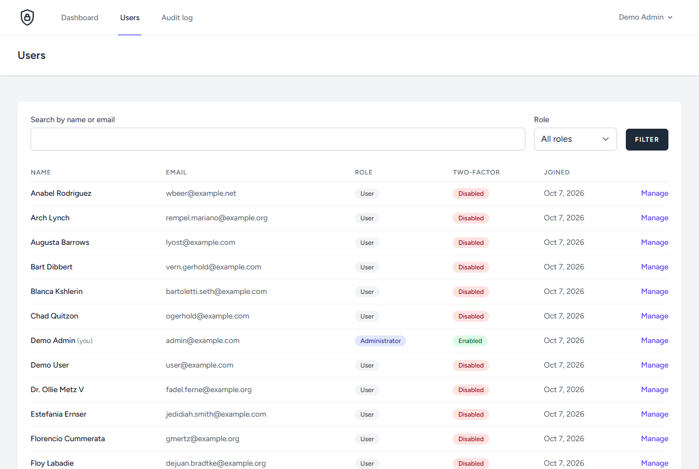
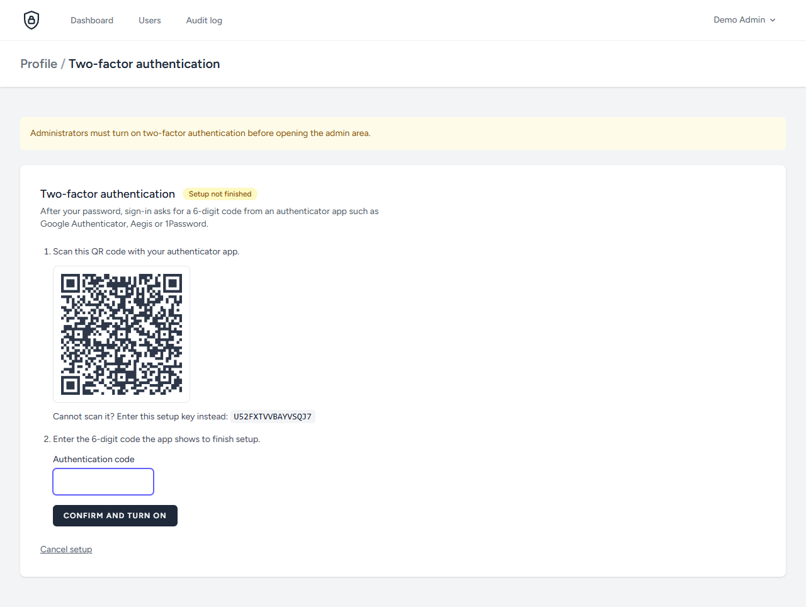
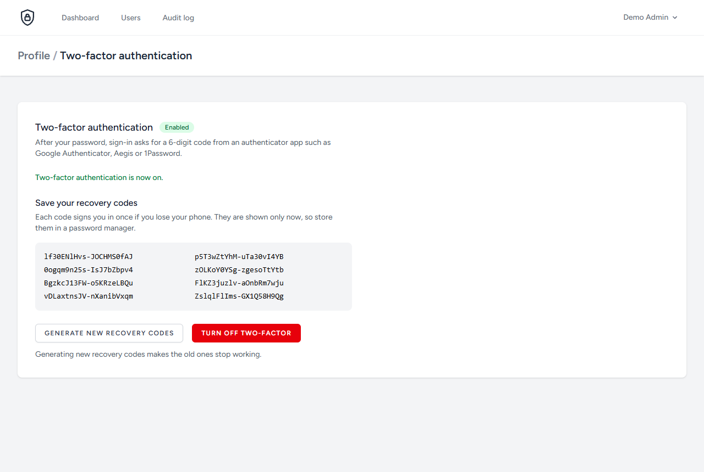
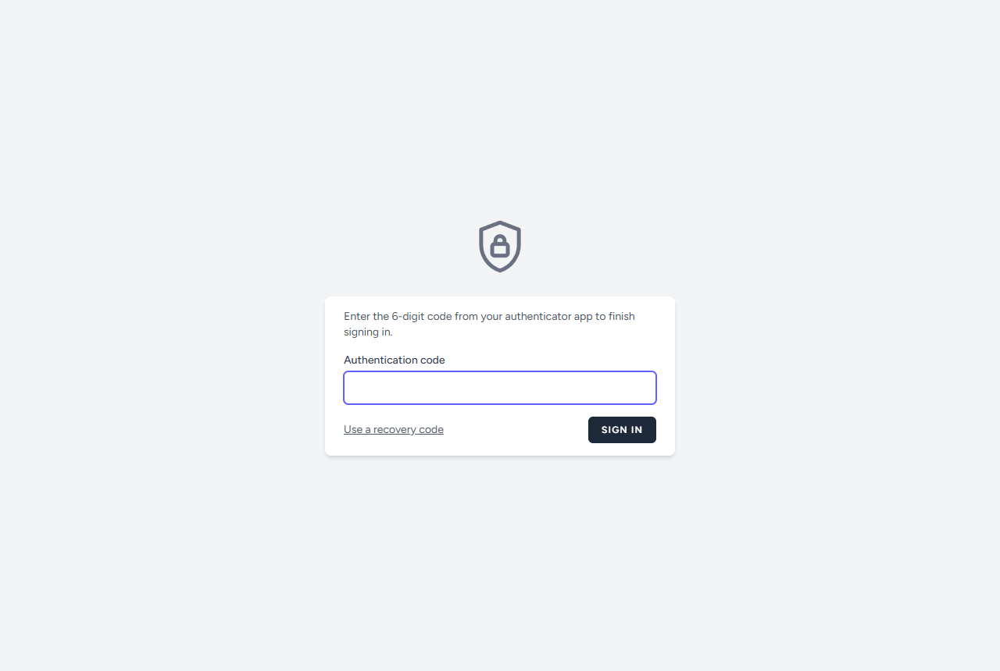
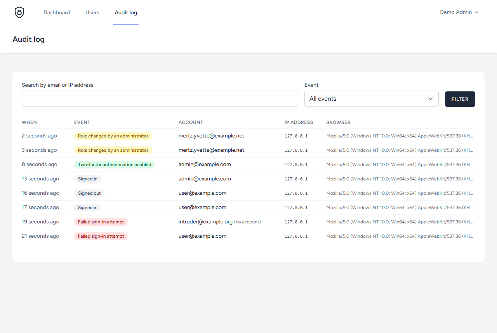
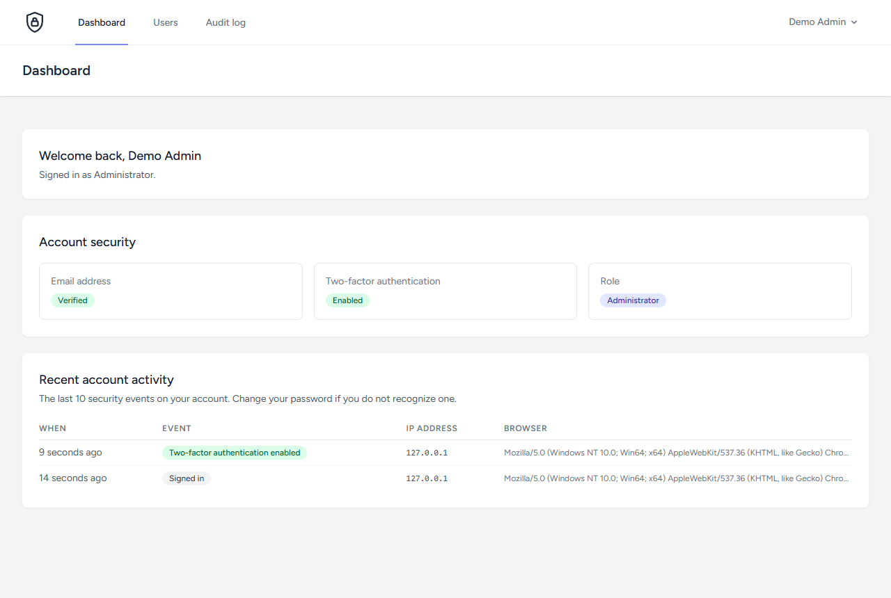
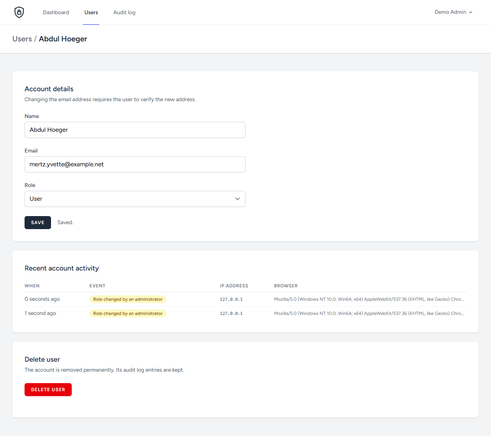

# PHP Cyber Uniproject

**English** | [ქართული](README.ka.md)

[](https://github.com/MrTabaOfficial/PHP-Cyber-Uniproject/actions/workflows/ci.yml)


[](LICENSE)

A Laravel application about one topic: keeping user accounts secure. It implements two-factor sign-in, role-based access to an admin panel, an audit log of security events and strict browser security headers, and it tests each of them.

The project started as university coursework for a cyber security module in December 2023. It was reworked in October 2026: upgraded from Laravel 10 to 13, the broken role handling was fixed, and the admin panel, audit log, two-factor flow, headers and tests were added.



## Features

| Feature | What it does | Where to look |
| --- | --- | --- |
| Two-factor authentication | TOTP codes from an authenticator app. Setup is only active after a code is confirmed. Eight single-use recovery codes are shown once. | [two-factor.blade.php](resources/views/profile/two-factor.blade.php), [config/fortify.php](config/fortify.php) |
| Mandatory two-factor for admins | An administrator without two-factor is sent to the setup page instead of the admin area. | [EnsureTwoFactorEnabled.php](app/Http/Middleware/EnsureTwoFactorEnabled.php) |
| Role-based access control | An enum-backed `role` column, a policy and a middleware. The role is not mass assignable. | [Role.php](app/Enums/Role.php), [UserPolicy.php](app/Policies/UserPolicy.php), [EnsureUserIsAdmin.php](app/Http/Middleware/EnsureUserIsAdmin.php) |
| Admin panel | Search and filter users, edit name, email and role, delete users, review each account's recent activity. | [UserController.php](app/Http/Controllers/Admin/UserController.php) |
| Security audit log | Records sign-ins, failed attempts, lockouts, logouts, password and two-factor changes and admin actions with IP address and browser. | [RecordSecurityEvents.php](app/Listeners/RecordSecurityEvents.php), [SecurityEvent.php](app/Models/SecurityEvent.php) |
| Security headers | Content Security Policy, anti-framing, `nosniff`, referrer and permissions policies, HSTS on HTTPS, `no-store` for signed-in pages. | [SecurityHeaders.php](app/Http/Middleware/SecurityHeaders.php) |
| Password policy | 12 or more characters with upper case, lower case, a number and a symbol. Checked against known breaches in production. | [AppServiceProvider.php](app/Providers/AppServiceProvider.php) |
| Rate limiting | 5 sign-in attempts per minute per email and IP address, 5 two-factor attempts per minute, 6 per minute on registration and password reset. | [FortifyServiceProvider.php](app/Providers/FortifyServiceProvider.php), [routes/auth.php](routes/auth.php) |
| Email verification | The dashboard and admin area require a verified email address. | [routes/web.php](routes/web.php) |

## Screenshots

| Two-factor setup | Recovery codes |
| --- | --- |
|  |  |

| Sign-in challenge | Audit log |
| --- | --- |
|  |  |

| Dashboard | Editing a user |
| --- | --- |
|  |  |

The secret and recovery codes in these screenshots belong to a local demo database that no longer exists.

## Threats and controls

| Threat | Control | Test |
| --- | --- | --- |
| Password guessing | Rate limit per email and IP address. Every failure and lockout is logged. | [AuditLogTest](tests/Feature/Security/AuditLogTest.php) |
| Stolen password | Two-factor challenge after the password step. The session is not authenticated until the code is accepted. | [TwoFactorAuthenticationTest](tests/Feature/Security/TwoFactorAuthenticationTest.php) |
| Weak passwords | One password policy for registration, change and reset. | [PasswordPolicyTest](tests/Feature/Security/PasswordPolicyTest.php) |
| Privilege escalation | `role` is excluded from mass assignment. Admin routes need the admin middleware and a policy check. Nobody can change their own role. | [RoleTest](tests/Feature/RoleTest.php), [UserManagementTest](tests/Feature/Admin/UserManagementTest.php) |
| Losing the last administrator | An admin cannot delete or demote themselves in the panel, and the only admin cannot delete their own account. | [UserManagementTest](tests/Feature/Admin/UserManagementTest.php) |
| Cross-site scripting | Blade escapes output. The Content Security Policy blocks inline scripts and inline event handlers, and the views contain none. | [SecurityHeadersTest](tests/Feature/Security/SecurityHeadersTest.php) |
| Clickjacking | `X-Frame-Options: DENY` and `frame-ancestors 'none'`. | [SecurityHeadersTest](tests/Feature/Security/SecurityHeadersTest.php) |
| Cross-site request forgery | Laravel's CSRF token on every state-changing form, plus `form-action 'self'`. | Framework default |
| Page restored from cache after logout | `Cache-Control: no-store` on responses for signed-in users. | [SecurityHeadersTest](tests/Feature/Security/SecurityHeadersTest.php) |
| Unnoticed account takeover | Users see their own recent security events on the dashboard. Admins see all events. Events survive account deletion. | [AuditLogTest](tests/Feature/Security/AuditLogTest.php) |
| Changing two-factor from an unattended session | The two-factor settings page and every two-factor action require a recently confirmed password. | [TwoFactorAuthenticationTest](tests/Feature/Security/TwoFactorAuthenticationTest.php) |

## Run it locally

Requirements: PHP 8.3 or newer with the `pdo_sqlite`, `mbstring`, `openssl` and `fileinfo` extensions, Composer 2, and Node.js 20 or newer.

1. Install the dependencies.

   ```bash
   composer install
   npm install
   ```

2. Create `.env`, the SQLite database and the demo accounts.

   ```bash
   composer setup
   ```

3. Build the assets and start the server.

   ```bash
   npm run build
   php artisan serve
   ```

4. Open <http://localhost:8000>.

`composer setup` runs `migrate:fresh --seed`, so it erases the local database each time.

### Demo accounts

| Role | Email | Password |
| --- | --- | --- |
| Administrator | `admin@example.com` | `Demo-Passw0rd!` |
| User | `user@example.com` | `Demo-Passw0rd!` |

The seeder refuses to create these accounts when `APP_ENV=production`.

To try the full flow, sign in as the administrator and open **Users**. The app asks for the password again and then walks through two-factor setup with any authenticator app.

Verification and password reset emails are not sent. With `MAIL_MAILER=log` they are written to `storage/logs/laravel.log`.

## Tests

```bash
composer test   # 86 feature tests on in-memory SQLite
composer lint   # code style check with Laravel Pint
```

The two-factor tests generate real TOTP codes from the stored secret instead of mocking the provider. The same flow was also run in headless Chrome with the Content Security Policy active, with no console errors.

GitHub Actions runs the tests, the style check, the asset build, `composer audit` and `npm audit` on every push and pull request. See [ci.yml](.github/workflows/ci.yml).

## Project structure

Only the parts specific to this project are shown. Everything else is the standard Laravel layout.

```text
PHP-Cyber-Uniproject/
├── .github/workflows/ci.yml            # build, style check, tests, dependency audits
├── app/
│   ├── Enums/
│   │   ├── Role.php                    # user / admin
│   │   └── SecurityEventType.php       # every audit log event, with label and color
│   ├── Http/
│   │   ├── Controllers/
│   │   │   ├── Admin/
│   │   │   │   ├── AuditLogController.php
│   │   │   │   └── UserController.php  # list, edit, role change, delete
│   │   │   ├── Auth/                   # registration, verification, password reset
│   │   │   ├── DashboardController.php
│   │   │   ├── ProfileController.php
│   │   │   └── TwoFactorSettingsController.php
│   │   ├── Middleware/
│   │   │   ├── EnsureTwoFactorEnabled.php  # admins must have two-factor
│   │   │   ├── EnsureUserIsAdmin.php
│   │   │   └── SecurityHeaders.php     # CSP, HSTS, anti-framing, no-store
│   │   └── Requests/Admin/UpdateUserRequest.php
│   ├── Listeners/RecordSecurityEvents.php  # auth events -> audit log
│   ├── Models/
│   │   ├── SecurityEvent.php
│   │   └── User.php
│   ├── Policies/UserPolicy.php
│   └── Providers/
│       ├── AppServiceProvider.php      # password policy
│       └── FortifyServiceProvider.php  # login and two-factor rate limits
├── config/
│   ├── fortify.php                     # two-factor with confirmation
│   └── security.php                    # admin two-factor rule, audit retention
├── database/
│   ├── factories/UserFactory.php       # admin() and withTwoFactor() states
│   ├── migrations/                     # users, role, two-factor columns, security_events
│   └── seeders/DatabaseSeeder.php      # demo accounts
├── docs/screenshots/
├── resources/
│   ├── css/app.css                     # Tailwind CSS 4 configuration
│   ├── js/app.js                       # Alpine.js
│   └── views/
│       ├── admin/                      # users and audit log pages
│       ├── auth/                       # login, register, two-factor challenge
│       ├── components/                 # buttons, badges, security events table
│       ├── profile/                    # profile and two-factor settings
│       ├── dashboard.blade.php
│       └── welcome.blade.php
├── routes/
│   ├── auth.php                        # registration, verification, password reset
│   └── web.php                         # dashboard, profile, admin area
└── tests/Feature/
    ├── Admin/UserManagementTest.php
    ├── Auth/                           # login, registration, reset, verification
    ├── Security/
    │   ├── AuditLogTest.php
    │   ├── ConfigurationTest.php
    │   ├── PasswordPolicyTest.php
    │   ├── SecurityHeadersTest.php
    │   └── TwoFactorAuthenticationTest.php
    ├── ProfileTest.php
    └── RoleTest.php
```

## Secrets and security settings

No secret is stored in the repository. Every secret comes from `.env`, which Git ignores.

| Item | How it is handled |
| --- | --- |
| `APP_KEY` | Empty in `.env.example` and generated per installation by `composer setup`. It encrypts cookies, sessions and two-factor secrets. |
| Passwords | Stored as bcrypt hashes with 12 rounds. Never logged, including in the audit log. |
| Two-factor secret and recovery codes | Encrypted in the database with `APP_KEY` and hidden from model serialization. |
| Session | Data encrypted at rest. The cookie is `HttpOnly`, `SameSite=Lax` and HTTPS-only when `APP_ENV=production`. |
| Password confirmation | Valid for 15 minutes before two-factor settings ask for the password again. |
| Host header | Requests for a host other than `APP_URL` and its subdomains are rejected outside local development, so password reset links cannot be pointed at another domain. |
| API | No API routes are exposed. |
| Demo password | `Demo-Passw0rd!` is public on purpose. The seeder does not run when `APP_ENV=production`. |

Before deploying, set `APP_ENV=production`, `APP_DEBUG=false` and a real `APP_URL`. Changing `APP_KEY` later makes existing two-factor secrets unreadable, so users would have to set up two-factor again.

These settings are checked in [ConfigurationTest](tests/Feature/Security/ConfigurationTest.php).

## Configuration

| Variable | Default | Meaning |
| --- | --- | --- |
| `SECURITY_ADMIN_REQUIRES_2FA` | `true` | Administrators must enable two-factor before using the admin area. |
| `SECURITY_AUDIT_RETENTION_DAYS` | `90` | Age at which the daily `model:prune` schedule deletes a security event. |
| `SESSION_SECURE_COOKIE` | `true` in production | Send the session cookie over HTTPS only. |
| `SESSION_ENCRYPT` | `true` | Encrypt session data at rest. |
| `AUTH_PASSWORD_TIMEOUT` | `900` | Seconds a password confirmation stays valid. |

## Known limitations

- The Content Security Policy allows `'unsafe-eval'` for scripts. Alpine.js needs it to evaluate its inline expressions. Inline scripts stay blocked.
- Rate limiting is per email and IP address. An attacker who rotates IP addresses is slowed only per address. There is no CAPTCHA.
- The audit log is a normal database table. An attacker with database access could alter it.
- The pruning schedule needs the Laravel scheduler (`php artisan schedule:work` or a cron entry) to be running.
- The application has not been deployed or load tested. It is a learning project, not a production service.

## License

Released under the [MIT License](LICENSE).
