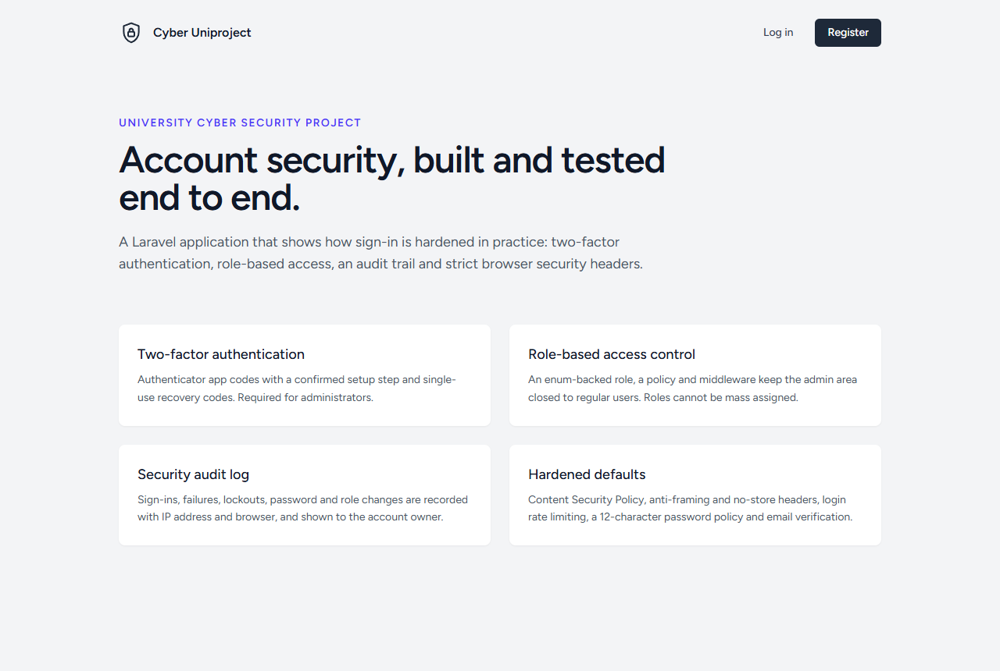
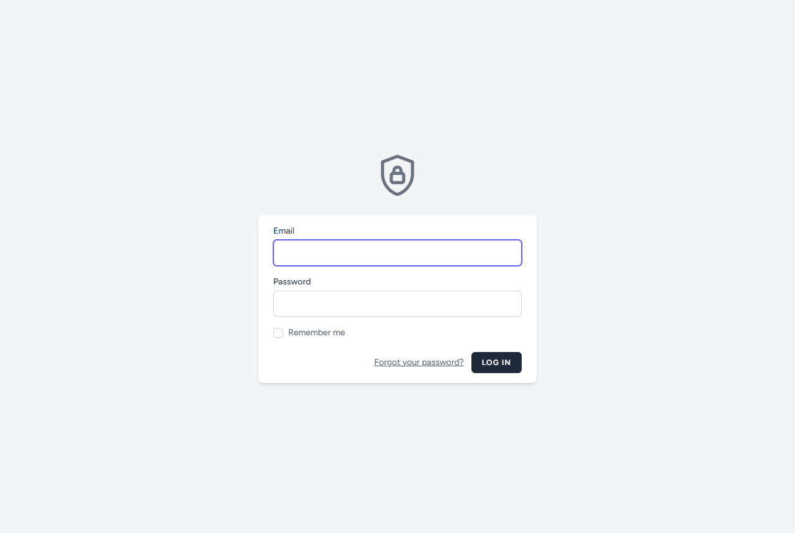
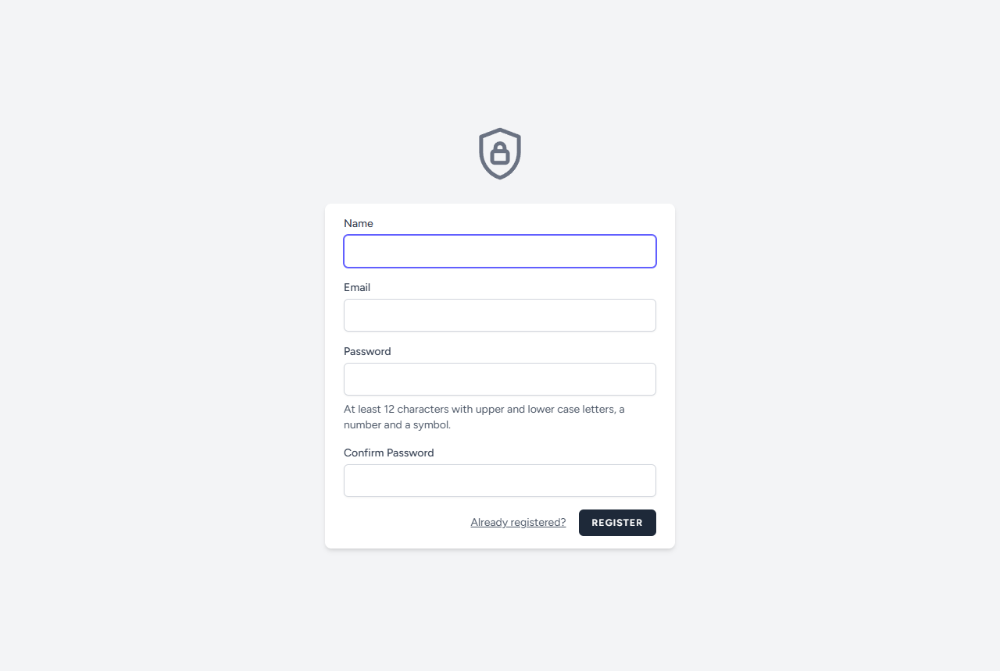
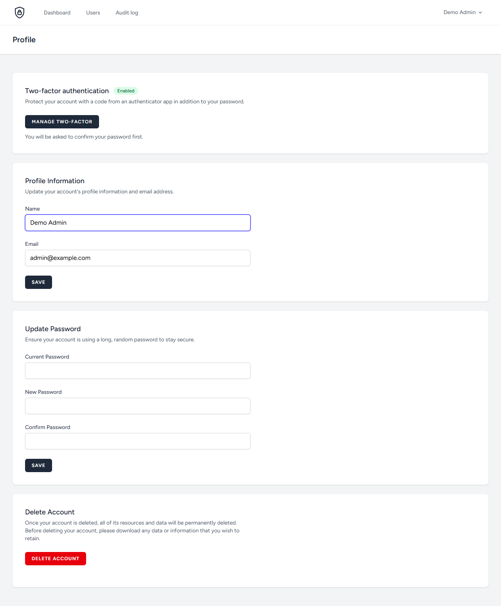
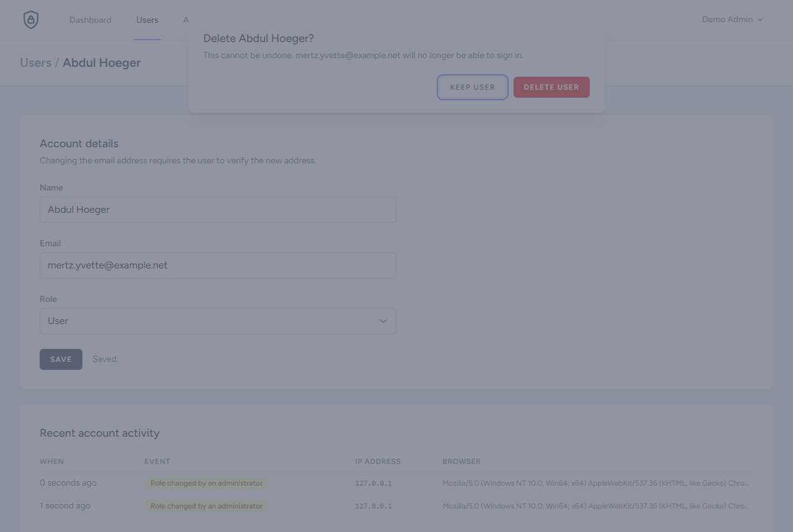
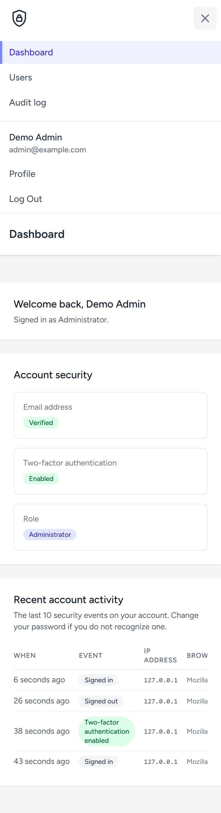
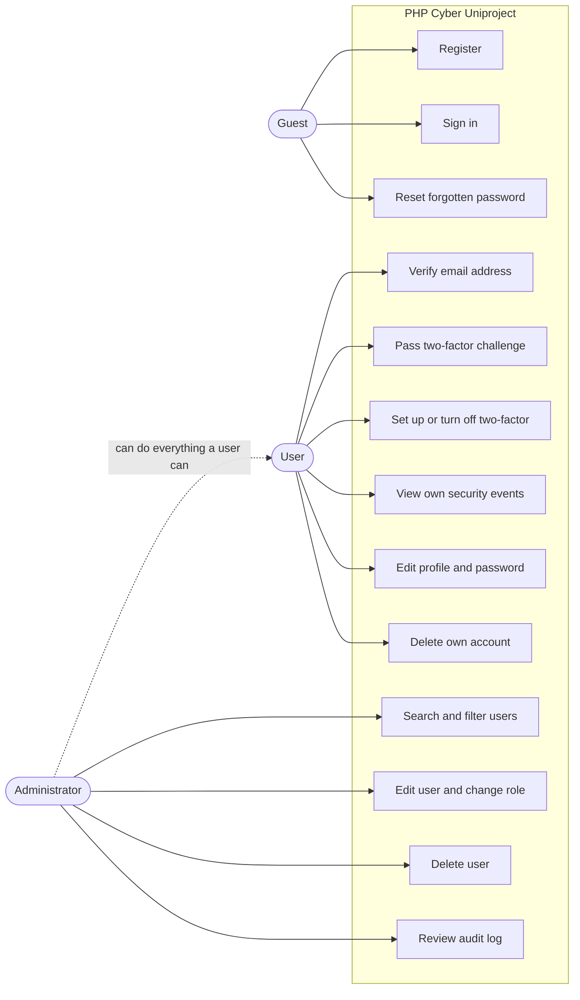
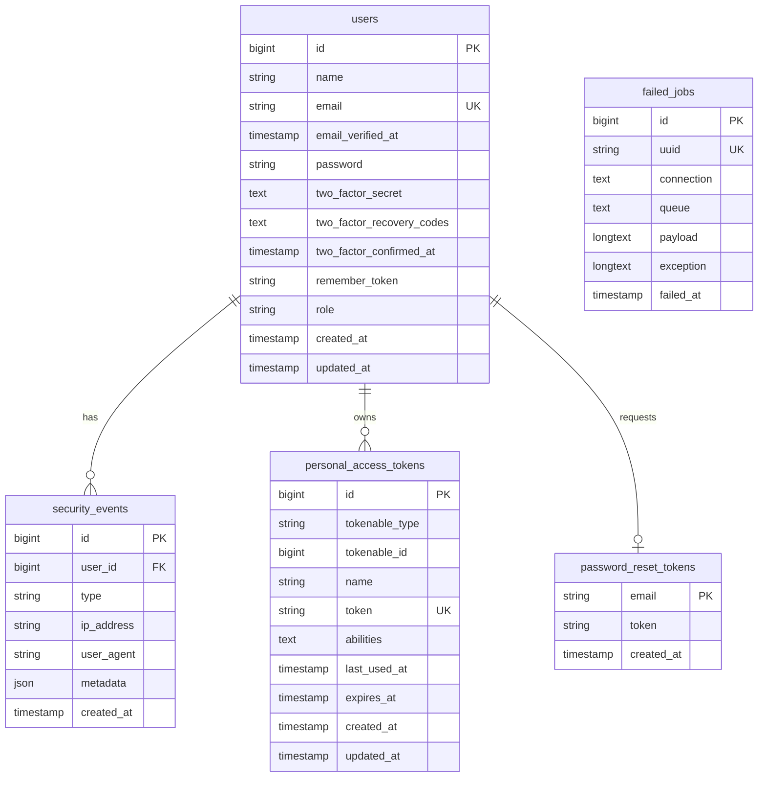

<h1 align="center">PHP Cyber Uniproject</h1>

<p align="center">
  A Laravel web app that demonstrates account security: two-factor sign-in, role-based access to an admin panel, a security audit log and browser security headers.
</p>

<p align="center">
  
  
  
  
  
  <a href="LICENSE"></a>
  <a href="https://github.com/MrTabaOfficial/PHP-Cyber-Uniproject/actions/workflows/ci.yml"></a>
</p>

<p align="center">
  <strong>English</strong> | <a href="README.ka.md">ქართული</a>
</p>


## About

The app is a small account system. A visitor registers and verifies their email address. A signed-in user manages their profile, turns on two-factor authentication and sees the recent security events on their own account. An administrator manages users and reads the audit log of every account. Nobody uses it in production; it exists to show how these protections are built and tested.

I started it in December 2023 as a university project on cyber security, with login, a QR code for two-factor authentication and a first attempt at an admin page. In October 2026 I reworked it: I moved it from Laravel 10 to Laravel 13, fixed the role check that crashed, and added the admin panel, the audit log, the full two-factor flow, the security headers and the tests. I used it to practise Laravel Fortify, TOTP two-factor authentication, policies and middleware, event listeners, HTTP security headers and feature testing.

> [!NOTE]
> This is a learning project with sample data. The seeder creates demo accounts with a public password and 18 fake users. It is not deployed anywhere.

## Contents

- [Features](#features)
- [Screenshots](#screenshots)
- [Use case diagram](#use-case-diagram)
- [Database](#database)
- [Tech stack](#tech-stack)
- [Project structure](#project-structure)
- [Setup](#setup)
- [Routes](#routes)
- [Security](#security)
- [Credits](#credits)
- [License](#license)

## Features

**Public site**

- Read a landing page that describes the project.
- Register with a name, an email address and a password that meets the password policy.
- Request a password reset link and set a new password.

**Accounts**

- Sign in with email and password, with an optional "remember me".
- Verify the email address through a signed link.
- Turn on two-factor authentication by scanning a QR code, or typing the setup key, and confirming a 6-digit code.
- Save eight single-use recovery codes, generate new ones, or turn two-factor off.
- Sign in with a 6-digit code or a recovery code after the password.
- See the email, two-factor and role status of the account on the dashboard.
- See the last 10 security events on the account, with time, IP address and browser.
- Change name, email and password, or delete the account.

**Administration**

- Search users by name or email and filter them by role.
- See which users have a verified email and two-factor turned on.
- Change a user's name, email and role, and see that user's recent security events.
- Delete a user after a confirmation dialog.
- Read the audit log of all accounts and filter it by event type, email or IP address.

## Screenshots

| Landing page | Sign in |
| --- | --- |
|  |  |

| Register | Dashboard |
| --- | --- |
|  |  |

| Profile | Two-factor setup |
| --- | --- |
|  |  |

| Recovery codes | Two-factor challenge |
| --- | --- |
|  |  |

| Users | Edit user |
| --- | --- |
|  |  |

| Delete confirmation | Audit log |
| --- | --- |
|  |  |

Mobile, with the menu open:



The setup key and recovery codes in these screenshots come from a local demo database that has since been reset.

## Use case diagram



## Database



A user has many security events, and `security_events.user_id` is set to null when the user is deleted so the record stays. `password_reset_tokens` is matched to a user by email without a foreign key. `personal_access_tokens` and `failed_jobs` come from the Laravel skeleton and no feature of this app writes to them.

## Tech stack

| Layer | Technology |
| --- | --- |
| Language | PHP 8.3+ |
| Framework | Laravel 13 |
| Authentication | Laravel Fortify 1.41 (login, password confirmation, TOTP two-factor) |
| Database | SQLite by default, through Eloquent and migrations |
| Templates | Blade components |
| Styling | Tailwind CSS 4 with `@tailwindcss/forms` |
| Client-side behaviour | Alpine.js 3 (dropdown, modal, mobile menu) |
| Asset build | Vite 8 with `laravel-vite-plugin` |
| Tests | PHPUnit 12, 86 feature tests on in-memory SQLite |
| Code style | Laravel Pint |
| CI | GitHub Actions |

## Project structure

```text
PHP-Cyber-Uniproject/
├── .github/workflows/ci.yml            # build, style check, tests, dependency audits
├── app/
│   ├── Enums/
│   │   ├── Role.php                    # user / admin
│   │   └── SecurityEventType.php       # every audit log event, with label and color
│   ├── Http/
│   │   ├── Controllers/
│   │   │   ├── Admin/
│   │   │   │   ├── AuditLogController.php  # filterable list of all events
│   │   │   │   └── UserController.php  # list, edit, role change, delete
│   │   │   ├── Auth/                   # registration, verification, password reset
│   │   │   ├── DashboardController.php # account status and own events
│   │   │   ├── ProfileController.php   # edit profile, delete account
│   │   │   └── TwoFactorSettingsController.php  # two-factor settings page
│   │   ├── Middleware/
│   │   │   ├── EnsureTwoFactorEnabled.php  # admins must have two-factor
│   │   │   ├── EnsureUserIsAdmin.php   # 403 for non-admins
│   │   │   └── SecurityHeaders.php     # CSP, HSTS, anti-framing, no-store
│   │   └── Requests/Admin/UpdateUserRequest.php  # validation for the user edit form
│   ├── Listeners/RecordSecurityEvents.php  # auth events -> audit log
│   ├── Models/
│   │   ├── SecurityEvent.php           # one audit log row, pruned after 90 days
│   │   └── User.php                    # role cast, two-factor, events relation
│   ├── Policies/UserPolicy.php         # who may edit, change role, delete
│   └── Providers/
│       ├── AppServiceProvider.php      # password policy
│       └── FortifyServiceProvider.php  # login and two-factor rate limits
├── config/
│   ├── fortify.php                     # two-factor with confirmation
│   └── security.php                    # admin two-factor rule, audit retention
├── database/
│   ├── factories/UserFactory.php       # admin() and withTwoFactor() states
│   ├── migrations/                     # users, role, two-factor columns, security_events
│   └── seeders/DatabaseSeeder.php      # demo accounts and sample users
├── docs/screenshots/                   # images used in this README
├── resources/
│   ├── css/app.css                     # Tailwind CSS 4 configuration
│   ├── js/app.js                       # starts Alpine.js
│   └── views/
│       ├── admin/                      # users and audit log pages
│       ├── auth/                       # login, register, two-factor challenge
│       ├── components/                 # buttons, badges, security events table
│       ├── layouts/                    # app and guest layouts, navigation
│       ├── profile/                    # profile and two-factor settings
│       ├── dashboard.blade.php         # dashboard
│       └── welcome.blade.php           # landing page
├── routes/
│   ├── auth.php                        # registration, verification, password reset
│   └── web.php                         # dashboard, profile, admin area
└── tests/Feature/
    ├── Admin/UserManagementTest.php    # access control, role changes, deletion
    ├── Auth/                           # login, registration, reset, verification
    ├── Security/
    │   ├── AuditLogTest.php            # which events are recorded
    │   ├── ConfigurationTest.php       # secrets, session, host validation
    │   ├── PasswordPolicyTest.php      # weak passwords are rejected
    │   ├── SecurityHeadersTest.php     # headers and no inline scripts
    │   └── TwoFactorAuthenticationTest.php  # setup, challenge, recovery codes
    ├── ProfileTest.php                 # profile update and account deletion
    └── RoleTest.php                    # default role, mass assignment
```

## Setup

Requirements:

- PHP 8.3 or newer with the `pdo_sqlite`, `mbstring`, `openssl` and `fileinfo` extensions
- Composer 2
- Node.js 20 or newer

Steps:

1. Clone the repository.

   ```bash
   git clone https://github.com/MrTabaOfficial/PHP-Cyber-Uniproject.git
   cd PHP-Cyber-Uniproject
   ```

2. Install the PHP and JavaScript dependencies.

   ```bash
   composer install
   npm ci
   ```

3. Create `.env`, the application key, the SQLite database file `database/database.sqlite`, the tables and the sample data.

   ```bash
   composer setup
   ```

   This command runs `migrate:fresh --seed`, so it erases the local database each time.

4. Build the CSS and JavaScript.

   ```bash
   npm run build
   ```

5. Start the server and open <http://localhost:8000>.

   ```bash
   php artisan serve
   ```

First login:

| Role | Email | Password |
| --- | --- | --- |
| Administrator | `admin@example.com` | `Demo-Passw0rd!` |
| User | `user@example.com` | `Demo-Passw0rd!` |

The administrator has to set up two-factor authentication before the admin pages open. Sign in, click **Users**, confirm the password and scan the QR code with any authenticator app.

Emails are not sent. With the default `MAIL_MAILER=log`, verification and password reset links are written to `storage/logs/laravel.log`.

Tests and code style:

```bash
composer test
composer lint
```

Settings in `.env`:

| Variable | Default | Meaning |
| --- | --- | --- |
| `SECURITY_ADMIN_REQUIRES_2FA` | `true` | Administrators must turn on two-factor before using the admin pages. |
| `SECURITY_AUDIT_RETENTION_DAYS` | `90` | Age at which the daily `model:prune` schedule deletes a security event. |
| `SESSION_ENCRYPT` | `true` | Encrypt session data at rest. |
| `SESSION_SECURE_COOKIE` | `true` in production | Send the session cookie over HTTPS only. |
| `AUTH_PASSWORD_TIMEOUT` | `900` | Seconds a password confirmation stays valid. |

## Routes

"Signed in" means any authenticated user. "Confirmed" means the password was re-entered in the last 15 minutes.

| Method | Path | Access | Purpose |
| --- | --- | --- | --- |
| GET | `/` | Everyone | Landing page |
| GET, POST | `/register` | Guests | Registration form and submit |
| GET, POST | `/login` | Guests | Sign-in form and submit |
| GET, POST | `/two-factor-challenge` | Guests who passed the password step | Enter a 6-digit code or a recovery code |
| GET, POST | `/forgot-password` | Guests | Request a password reset link |
| GET | `/reset-password/{token}` | Guests | New password form |
| POST | `/reset-password` | Guests | Save the new password |
| POST | `/logout` | Signed in | Sign out |
| GET | `/verify-email` | Signed in | Prompt to verify the email address |
| GET | `/verify-email/{id}/{hash}` | Signed in, signed URL | Verify the email address |
| POST | `/email/verification-notification` | Signed in | Send the verification link again |
| GET, POST | `/user/confirm-password` | Signed in | Password confirmation form and submit |
| GET | `/user/confirmed-password-status` | Signed in | Whether the password was confirmed recently (JSON) |
| GET | `/dashboard` | Signed in, verified email | Account security status and recent events |
| GET | `/profile` | Signed in | Profile page |
| PATCH | `/profile` | Signed in | Update name and email |
| DELETE | `/profile` | Signed in | Delete own account |
| PUT | `/password` | Signed in | Change password |
| GET | `/profile/two-factor` | Signed in, confirmed | Two-factor settings page |
| POST | `/user/two-factor-authentication` | Signed in, confirmed | Start two-factor setup |
| POST | `/user/confirmed-two-factor-authentication` | Signed in, confirmed | Confirm setup with a code |
| DELETE | `/user/two-factor-authentication` | Signed in, confirmed | Turn two-factor off |
| GET | `/user/two-factor-qr-code` | Signed in, confirmed | QR code (JSON) |
| GET | `/user/two-factor-secret-key` | Signed in, confirmed | Setup key (JSON) |
| GET | `/user/two-factor-recovery-codes` | Signed in, confirmed | Recovery codes (JSON) |
| POST | `/user/two-factor-recovery-codes` | Signed in, confirmed | Generate new recovery codes |
| GET | `/admin/users` | Administrator | User list with search and role filter |
| GET | `/admin/users/{user}/edit` | Administrator | User edit page |
| PUT, PATCH | `/admin/users/{user}` | Administrator | Update name, email and role |
| DELETE | `/admin/users/{user}` | Administrator | Delete the user |
| GET | `/admin/audit-log` | Administrator | Audit log with filters |

Administrator routes also require a verified email and, by default, two-factor turned on. The login, logout, password confirmation and `/user/two-factor-*` routes are registered by Laravel Fortify. Laravel Sanctum registers `GET /sanctum/csrf-cookie`, which this app does not use. There are no API routes.

## Security

Protections in the code:

- **Two-factor authentication.** TOTP codes, active only after a code is confirmed. Recovery codes work once. The session is not authenticated until the challenge is passed.
- **Mandatory two-factor for administrators.** `EnsureTwoFactorEnabled` sends an administrator without it to the setup page.
- **Role-based access.** The `role` column is not mass assignable. Admin routes need the `admin` middleware and a `UserPolicy` check. Nobody can change their own role or delete themselves in the admin panel, and the only administrator cannot delete their own account.
- **Password policy.** At least 12 characters with upper case, lower case, a number and a symbol. In production it also checks the password against known breaches.
- **Password storage.** bcrypt with 12 rounds.
- **Rate limiting.** 5 sign-in attempts per minute per email and IP address, 5 two-factor attempts per minute, 6 per minute on registration and password reset.
- **Audit log.** Sign-ins, failed attempts, lockouts, logouts, password and two-factor changes and admin actions are stored with IP address and browser. The submitted password is never stored. Events stay after the account is deleted.
- **Security headers.** Content Security Policy without inline scripts, `X-Frame-Options: DENY`, `X-Content-Type-Options: nosniff`, referrer and permissions policies, HSTS on HTTPS and `Cache-Control: no-store` for signed-in pages.
- **Sensitive actions need the password again.** Two-factor settings require a password confirmed in the last 15 minutes.
- **Encrypted secrets.** Two-factor secrets and recovery codes are encrypted in the database. Session data is encrypted at rest.
- **Session cookie.** `HttpOnly`, `SameSite=Lax`, and HTTPS-only when `APP_ENV=production`.
- **Host validation.** Outside local development, requests for a host other than `APP_URL` are rejected, so password reset links cannot point to another domain.
- **CSRF and XSS.** Laravel's CSRF token is on every form that changes data, and Blade escapes output.
- **No secrets in the repository.** `APP_KEY` is empty in `.env.example` and `.env` is ignored by Git.

Before deploying:

- Set `APP_ENV=production`, `APP_DEBUG=false` and the real `APP_URL`.
- Run `php artisan migrate` instead of `composer setup`, so the demo accounts are not created.
- Configure a real mailer in place of `MAIL_MAILER=log`.
- Serve the site over HTTPS.
- Run the Laravel scheduler, which deletes old audit log rows.
- Keep `APP_KEY` unchanged afterwards. Changing it makes stored two-factor secrets unreadable.

Limits I know about:

- The Content Security Policy allows `'unsafe-eval'` for scripts because Alpine.js needs it.
- Rate limiting is per email and IP address, and there is no CAPTCHA.
- The audit log is a normal table, so someone with database access could change it.
- I have only run the app on SQLite. The MySQL settings in `config/database.php` are untested.

## Credits

| Item | Use | License |
| --- | --- | --- |
| [Laravel](https://laravel.com) | Framework | MIT |
| [Laravel Fortify](https://github.com/laravel/fortify) | Login, password confirmation, two-factor | MIT |
| [Laravel Breeze](https://github.com/laravel/breeze) | Origin of the Blade layouts, form components and auth controllers | MIT |
| [Laravel Sanctum](https://github.com/laravel/sanctum), [Laravel Tinker](https://github.com/laravel/tinker), [Guzzle](https://github.com/guzzle/guzzle) | Installed with the Laravel skeleton | MIT |
| [pragmarx/google2fa](https://github.com/antonioribeiro/google2fa) | TOTP codes, installed by Fortify | MIT |
| [bacon/bacon-qr-code](https://github.com/Bacon/BaconQrCode) | QR code image, installed by Fortify | BSD-2-Clause |
| [Tailwind CSS](https://tailwindcss.com) and `@tailwindcss/forms` | Styling | MIT |
| [Alpine.js](https://alpinejs.dev) | Dropdown, modal, mobile menu | MIT |
| [Vite](https://vite.dev) and `laravel-vite-plugin` | Asset build | MIT |
| [PHPUnit](https://phpunit.de), [Mockery](https://github.com/mockery/mockery) | Tests | BSD-3-Clause |
| [Laravel Pint](https://github.com/laravel/pint), [Collision](https://github.com/nunomaduro/collision), [Faker](https://github.com/FakerPHP/Faker) | Code style, test output, sample data | MIT |
| [Figtree](https://fonts.bunny.net/family/figtree) | Font, loaded from Bunny Fonts | SIL Open Font License 1.1 |

The shield logo is an inline SVG drawn for this project. The app uses no stock images or icon packs.

## License

Released under the [MIT License](LICENSE).
